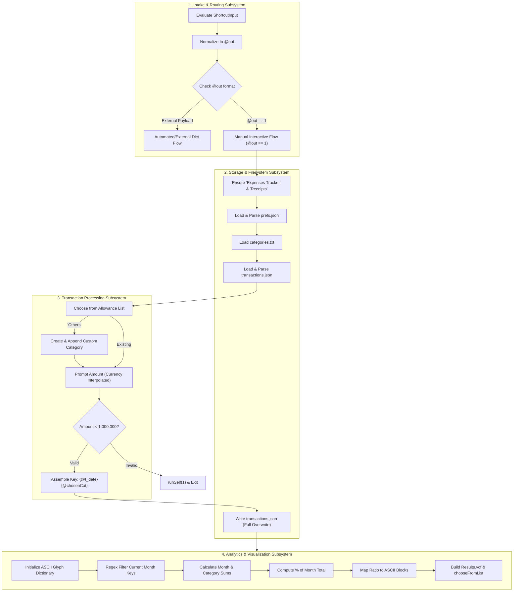
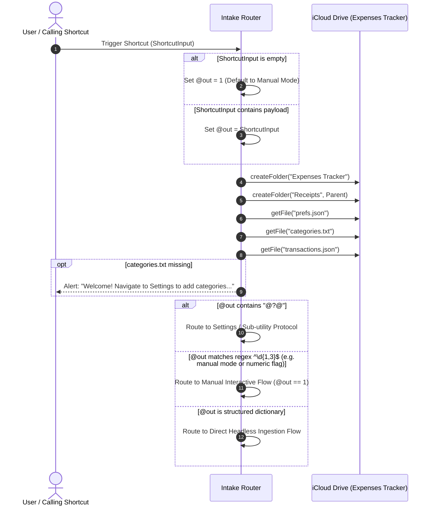
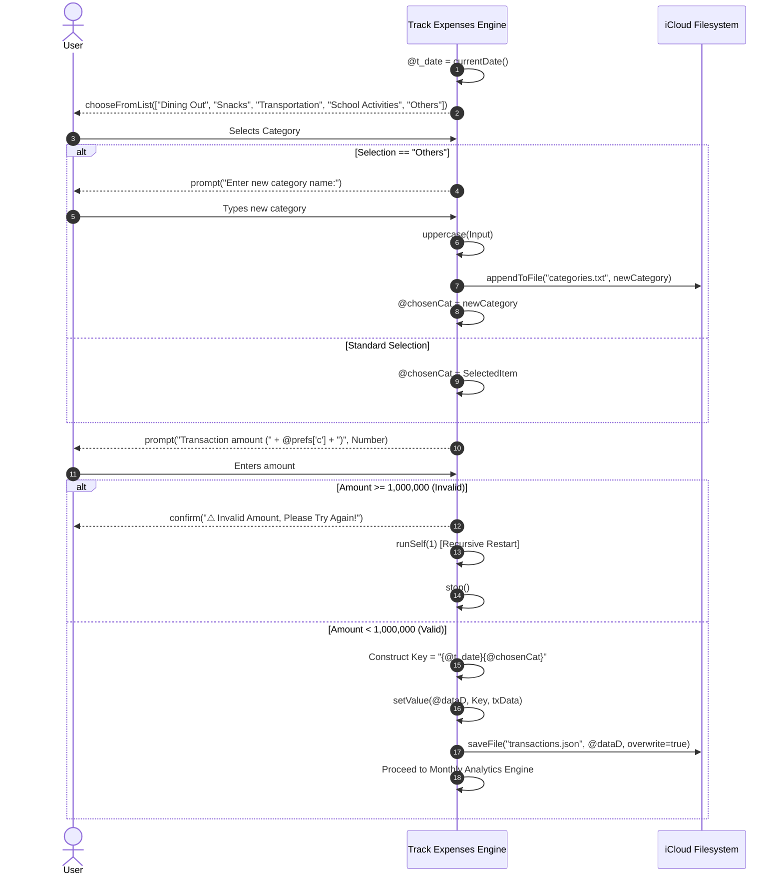
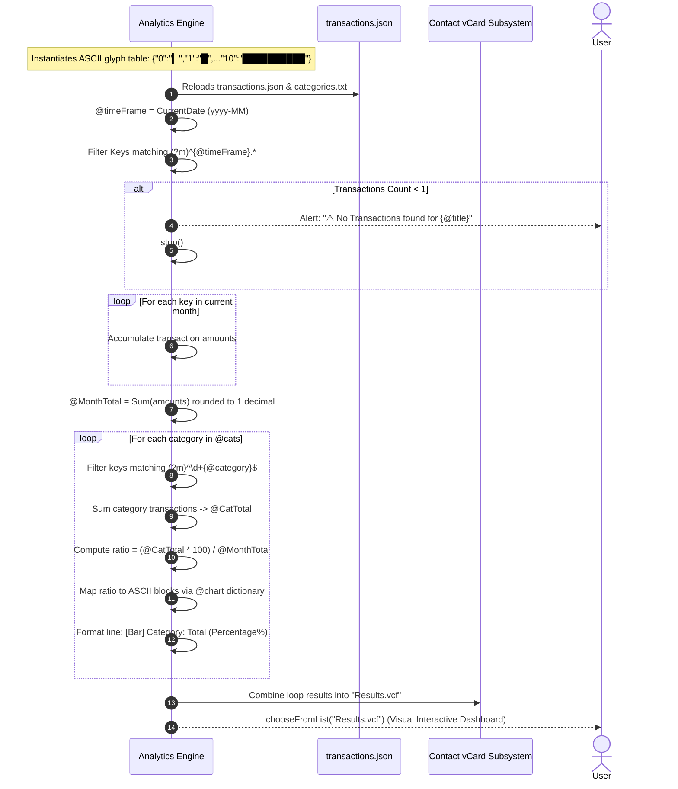

# Architecture Specification: Track Expenses (`Track_Expenses.cherri`)

## 1. Executive Summary & Purpose

`Track_Expenses.cherri` is an all-in-one expense tracking and immediate analytical reporting Apple Shortcut written in the [Cherri](https://cherrilang.org/) declarative programming language. It serves as both a transaction logger and an on-demand monthly analytics dashboard for personal expense management on iOS and macOS devices.

Unlike decoupled architectures that separate logging from visualization, `Track_Expenses.cherri` couples transaction input, dynamic category expansion, iCloud-based persistence, statistical aggregation, and an ASCII bar-chart dashboard rendered via Apple Shortcuts' Contact vCard subsystem into a single unified execution cycle.

```
┌─────────────────────────────────────────────────────────────────────────────┐
│                         Track_Expenses.cherri                               │
├───────────────────┬──────────────────────────┬──────────────────────────────┤
│ 1. Intake Router  │ 2. Transaction Engine    │ 3. Analytics & vCard Engine  │
│ - ShortcutInput   │ - Allowance Categories   │ - Timeframe Regex Filtering  │
│ - Regex ^\d{1,3}$ │ - Dynamic "Others" Add   │ - Monthly Category Sums      │
│ - External Dict   │ - 1M Bounds Validation   │ - ASCII Proportional Bars    │
│ - Fallback (@out) │ - iCloud JSON Sync       │ - Results.vcf Menu Render    │
└───────────────────┴──────────────────────────┴──────────────────────────────┘
```

---

## 2. System Context & Storage Topology

The shortcut operates directly inside Apple Shortcuts' sandboxed iCloud Drive container (`~/Library/Mobile Documents/iCloud~is~workflow~my~workflows/Documents/` or iOS Files `iCloud Drive/Shortcuts/`).

```
iCloud Drive/Shortcuts/
└── Expenses Tracker/                 <-- Root parent directory
    ├── prefs.json                    <-- Global user preferences & currency symbol
    ├── categories.txt                <-- Master list of category names (newline-separated)
    ├── transactions.json             <-- Monolithic dictionary of all logged records
    └── Receipts/                     <-- Attachment folder for receipts (created on setup)
```

### Storage Artefacts

| File | Type | Persistence Pattern | Purpose |
| :--- | :--- | :--- | :--- |
| `prefs.json` | JSON Object | Read-only at runtime | Stores configuration options, notably currency key `c` (e.g. `₱`, `$`, `€`). |
| `categories.txt` | Raw Text | Read / Append | Plaintext list of user categories. Dynamically expanded when user inputs a custom category under "Others". |
| `transactions.json` | JSON Object | Read / Full Rewrite | Primary datastore. Keyed by composite timestamp-category hashes `{timestamp}{category}`. |
| `Receipts/` | Directory | Idempotent Creation | Storage container for transaction receipts and invoice attachments. |

---

## 3. Component Architecture & Subsystems

The shortcut is organized into three major functional subsystems:



---

## 4. Architectural User Flows

### Flow 1: Initialization & Ingestion Routing



### Flow 2: Manual Transaction Logging Flow



### Flow 3: Inline Monthly Analytics & ASCII vCard Rendering



---

## 5. Detailed Data Schemas

### 5.1 `prefs.json` (Configuration)

```json
{
  "c": "₱",
  "note": false,
  "schemaVersion": 1
}
```

- `c` *(string)*: Currency symbol displayed in amount prompts and summary views (e.g. `₱`, `$`, `PHP`).
- `note` *(boolean)*: Optional flag indicating whether note capture is toggled.
- `schemaVersion` *(number)*: Schema version tracking.

### 5.2 `categories.txt` (Category Registry)

Plain newline-delimited ASCII/UTF-8 string:

```text
Dining Out
Snacks
Transportation
School Activities
Others
```

When custom categories are created during the "Others" prompt, they are converted to uppercase and appended as a new line.

### 5.3 `transactions.json` (Transaction Store)

The datastore is a monolithic dictionary where every transaction is stored under a composite key formed by concatenating the timestamp and category name:

```json
{
  "20261011160530Dining Out": {
    "am": 150.00,
    "stamp": "2026-10-11 16:05:30",
    "usr": "iPhone"
  },
  "20261011171240Transportation": {
    "am": 45.00,
    "stamp": "2026-10-11 17:12:40",
    "usr": "iPhone"
  }
}
```

#### Key Structure: `{timestamp}{category}`
- `timestamp`: Formatted date string (`yyyyMMddHHmmss` or locale string from `currentDate()`).
- `category`: Unmodified category string.

#### Value Fields:
- `am`: Numeric transaction value.
- `stamp`: ISO or localized timestamp of record entry.
- `usr`: Host device name retrieved from `getDeviceDetail("Device Name")`.

### 5.4 `Results.vcf` (ASCII Visual vCard Schema)

Apple Shortcuts lacks native charting controls (such as bar charts or pie graphs). `Track_Expenses.cherri` solves this by synthesizing a virtual contact card (`.vcf`) stream. When presented through `chooseFromList()`, Shortcuts renders each contact record as a formatted interactive card with an icon, title, and subtitle:

```vcard
BEGIN:VCARD
VERSION:3.0
N:;Dining Out;;;
FN:██████ Dining Out: ₱1,250.00 (45.2%)
NOTE:Total spent in category Dining Out
END:VCARD
```

---

## 6. Algorithmic Detail: ASCII Bar Chart Generation

The visual rendering engine maps numerical proportions to horizontal block characters using an in-memory lookup table:

```cherri
Text = "{\"0\":\"▎\",\"1\":\"█\",\"2\":\"██\",\"3\":\"███\",\"4\":\"████\",\"5\":\"█████\",\"6\":\"██████\",\"7\":\"███████\",\"8\":\"████████\",\"9\":\"█████████\",\"10\":\"██████████\"}"
```

### Proportional Mapping Algorithm

1. **Category Percentage Calculation**:
   $$\text{Ratio} = \frac{\text{CatTotal} \times 100}{\text{MonthTotal}}$$
2. **Ceiling & Range Normalization**:
   - `ceil(Ratio, "Ones Place")` produces an integer from $0$ to $100$.
3. **Decile Quantization**:
   - If $\text{Ratio} < 1$: Renders sub-block `▎` (`@chart['0']`).
   - If $\text{Ratio} == 100$: Renders 10 full blocks `██████████` (`@chart['10']`).
   - For values $10 \le \text{Ratio} \le 99$: Uses regular expression `^(\d)\d$` to extract the tens digit ($\text{decile} = \lfloor\text{Ratio} / 10\rfloor$) and indexes `@chart[tensDigit]`.
4. **Rendering**:
   - Concatenates `@bar`, category name, formatted currency sum, and percentage string.

---

## 7. Architectural Evaluation & Tradeoffs

While `Track_Expenses.cherri` achieves a complete logging and dashboard experience within a single shortcut, it presents several key architectural tradeoffs:

### 7.1 Identified Bottlenecks & Limitations

| Architectural Area | Implementation in `Track_Expenses.cherri` | Technical Consequence |
| :--- | :--- | :--- |
| **I/O Scaling** | Reads & writes entire `transactions.json` on every run. | **$O(N)$ file growth degradation**: As history grows to hundreds or thousands of transactions, JSON parsing latency increases exponentially, causing UI freezes on mobile devices. |
| **Error Handling & Recursion** | Calls `runSelf(1)` upon invalid amount entry or missing categories. | **Stack frame accumulation**: Spawns a secondary Shortcut process instance rather than looping in-memory, consuming OS memory and causing visual app flashing. |
| **Single Responsibility Principle** | Logs an expense and immediately calculates full monthly analytics in the same invocation. | **Unavoidable latency for fast logging**: A user logging a ₱50 coffee must wait for full statistical aggregation and vCard rendering before the shortcut terminates. |
| **Concurrency / Idempotency** | Monolithic dictionary overwrite without lock semantics. | **Risk of race conditions**: If triggered in rapid succession or across synchronized devices (Mac + iPhone), simultaneous writes can overwrite recent transactions. |
| **Category Fallbacks** | Hardcoded list (`Dining Out`, `Snacks`, etc.) in Cherri source alongside `categories.txt`. | **State drift**: Discrepancies can emerge between categories stored in `categories.txt` and the hardcoded picker list. |

### 7.2 Architectural Advantages

- **Zero External Dependencies**: Operates 100% offline using standard iCloud Drive storage without requiring databases, third-party companion apps, or web APIs.
- **Rich Visual Feedback without Custom Apps**: Leverages the vCard Contacts protocol to produce rich, readable visual progress bars natively inside the Shortcuts UI.
- **Bi-modal Invocation**: Capable of being invoked manually (via home screen/widget) or programmatically via dictionary input from Siri or webhooks.

---

## 8. Alignment with System Architecture Evolution

In the broader `Expenses Tracker` suite, `Track_Expenses.cherri` represents the **monolithic, feature-complete legacy architecture**. 

To address the $O(N)$ parsing bottleneck and execution latency, the next-generation architecture evolves along two separated paths:

```
                      Legacy Monolith (Track_Expenses.cherri)
                     [Input + Storage + Aggregation + vCard UI]
                                        │
                    ┌───────────────────┴───────────────────┐
                    ▼                                       ▼
     Fast Logger (log-expense.cherri)         Analytics Engine (Monthly Analytics)
     - Append-only (data/yyyy-MM.txt)         - Decoupled on-demand reporting
     - Zero transaction history reads         - Reads historical files only when requested
     - Sub-second execution (< 500ms)         - Rich charts, vCards, and breakdowns
     - In-run loop (no runSelf)               - Scheduled or manual execution
```

1. **Decoupled Fast Entry (`log-expense.cherri`)**:
   - Uses append-only text logs (`Expenses Tracker/data/yyyy-MM.txt`).
   - Does not read or parse transaction history when logging.
   - Replaces `runSelf(1)` with native Cherri `for retry in 50` loops.
   - Eliminates analytics overhead from the logging critical path.

2. **Dedicated Reporting Hub (`Monthly Analytics`)**:
   - Reuses the ASCII bar chart and vCard rendering algorithms pioneered in `Track_Expenses.cherri`.
   - Runs independently as a dedicated analytical reporting tool on a scheduled basis or manual request.
